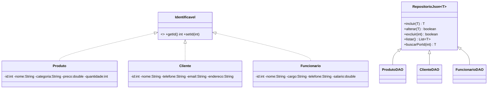

# 🌾 Padaria Doce Trigo

Aplicação web em **Java + JSP** para organizar os **produtos**, os **clientes** e os **funcionários** de uma padaria.
Projeto prático de Laboratório de Programação 2 (SPOLBP2) · IFSP São Paulo · Técnico em Desenvolvimento de Sistemas.

Autor: Gabriel das Graças

## Entidades

| Cadastro | Atributos (além do id) |
|---|---|
| **Produto** | nome, categoria, preco, quantidade |
| **Cliente** | nome, telefone, email, endereco |
| **Funcionario** | nome, cargo, telefone, salario |

Cada cadastro tem **incluir, alterar, excluir e listar**.

## Tecnologias

- Java (classes de entidade e persistência) e JSP/HTML
- **Gson** (`toJson()` / `fromJson()`) para ler e gravar JSON
- Arquivos **JSON** como persistência (sem banco de dados)
- CSS simples compartilhado (`css/estilo.css`)
- Servidor **Apache Tomcat** no Eclipse (Dynamic Web Project)

## Diagrama de classes


As entidades guardam os dados; as operações incluir/alterar/excluir/listar ficam em `RepositorioJson<T>`, herdado por `ProdutoDAO`, `ClienteDAO` e `FuncionarioDAO`.



## Estrutura de pastas

```
PadariaDoceTrigo/
├── src/
│   ├── classes/        Produto, Cliente, Funcionario
│   ├── persistencia/   Identificavel, RepositorioJson (Gson), ProdutoDAO, ClienteDAO, FuncionarioDAO
│   └── util/           Util (validação, formatação, escape de HTML)
├── WebContent/
│   ├── WEB-INF/        web.xml  e  lib/ (colocar o gson-2.x.jar aqui)
│   ├── dados/          produtos.json, clientes.json, funcionarios.json
│   ├── css/estilo.css
│   ├── includes/       cabecalho.jsp, rodape.jsp, config.jspf
│   ├── index.jsp
│   ├── produtos.jsp / produto-form.jsp / produto-excluir.jsp
│   ├── clientes.jsp / cliente-form.jsp / cliente-excluir.jsp
│   ├── funcionarios.jsp / funcionario-form.jsp / funcionario-excluir.jsp
│   └── erro.jsp
├── docs/               diagrama de classes
├── prints/             capturas de tela da evolução do projeto
└── apresentacao/       slides do 4º bimestre
```

## Exemplo de JSON (`produtos.json`)

```json
[
  {
    "id": 1,
    "nome": "Pão francês",
    "categoria": "Pão",
    "preco": 0.9,
    "quantidade": 200
  }
]
```

## Como rodar (Eclipse + Tomcat)

1. **File > New > Dynamic Web Project** com o nome `PadariaDoceTrigo`, runtime **Apache Tomcat**. Na última tela do assistente, defina o *Content directory* como `WebContent`.
2. Copie o conteúdo da pasta `src/` para `src/` do projeto e o conteúdo de `WebContent/` para `WebContent/` (substituindo o que o Eclipse criou).
3. Baixe o **gson-2.x.jar** em [mvnrepository.com/artifact/com.google.code.gson/gson](https://mvnrepository.com/artifact/com.google.code.gson/gson) e coloque em `WebContent/WEB-INF/lib/`. Depois: botão direito no projeto > **Properties > Java Build Path > Libraries** e confirme que a Gson aparece (se não, *Add JARs...*).
4. Botão direito em `index.jsp` > **Run As > Run on Server**.
5. Confira o console do Eclipse: não deve haver erro. Tire um print da tela inicial e salve em `prints/`.

> **Onde os dados ficam gravados:** por padrão o Eclipse publica o projeto numa pasta do Tomcat (`.metadata/.../wtpwebapps/PadariaDoceTrigo`), e é lá que os JSON são alterados. Para gravar direto na pasta do seu projeto, descomente o `<context-param>` `pastaDados` em `WEB-INF/web.xml` e coloque o caminho de `WebContent/dados`.

## Como atende aos requisitos

| Requisito | Onde |
|---|---|
| 3+ classes Java além das JSP | `Produto`, `Cliente`, `Funcionario` (+ DAOs) |
| 3 cadastros com incluir/alterar/excluir/listar | `*s.jsp`, `*-form.jsp`, `*-excluir.jsp` |
| 3+ atributos além do id | 4 em cada classe |
| JSON sem banco de dados | `WebContent/dados/*.json` |
| Gson (sem montar JSON com String) | `RepositorioJson`: `fromJson()` e `toJson()` |
| CSS simples | `css/estilo.css` |
| Tratamento de erros | `errorPage="erro.jsp"` em todas as páginas; `erro.jsp` com `isErrorPage="true"` e objeto `exception` |
| Cabeçalho e rodapé reaproveitados | `<%@ include file="includes/cabecalho.jsp" %>` e `rodape.jsp` |
| Pontos extras | Validação no servidor (campos obrigatórios, número inteiro, preço/salário com vírgula, telefone, e-mail) com mensagens claras; CSS caprichado e responsivo; 4 atributos por cadastro |

## Subindo para o GitHub

```bash
git init
git add .
git commit -m "estrutura inicial do projeto Padaria Doce Trigo"
git branch -M main
git remote add origin https://github.com/SEU-USUARIO/SEU-REPOSITORIO.git
git push -u origin main
```

Lembre de criar o repositório **privado** (nome: RA + nome do projeto) e de convidar o professor como colaborador.
